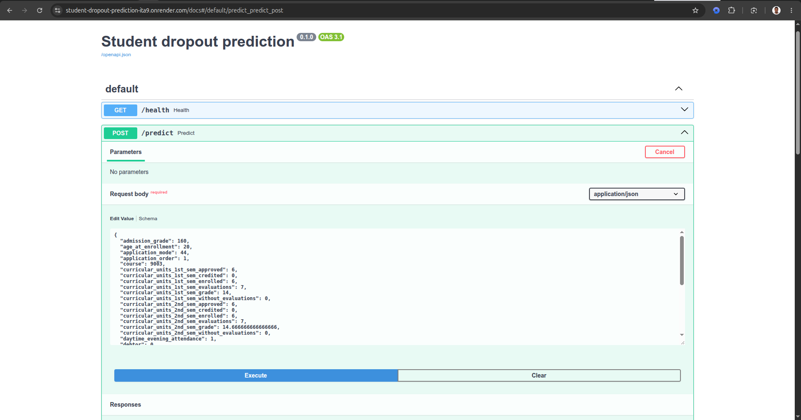
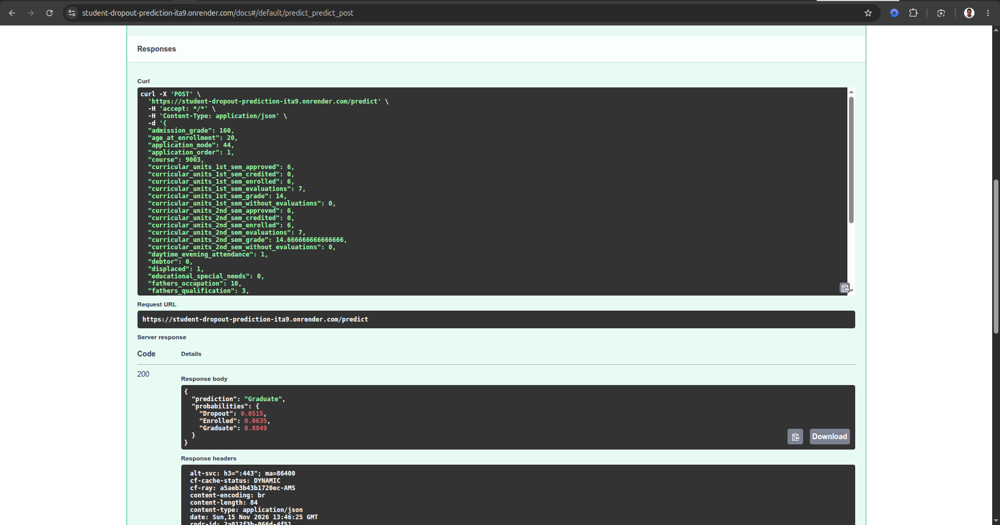
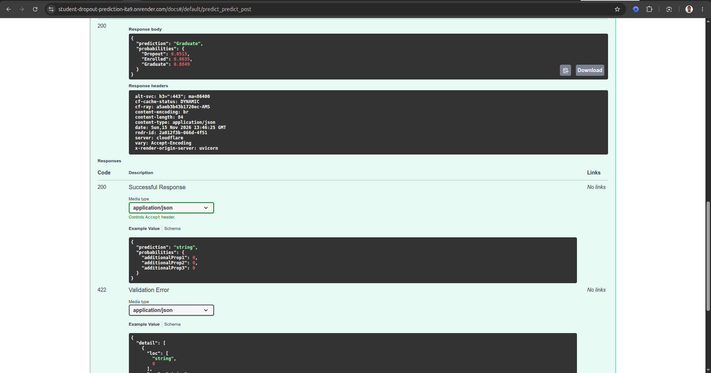

# Student Dropout Prediction

Predict whether a university student will **drop out**, stay **enrolled**, or **graduate**, using data known after the
student's second semester. Midterm project for [ML Zoomcamp 2026](https://github.com/DataTalksClub/machine-learning-zoomcamp)
(DataTalksClub).

```
data/data.csv ──► train.py ──► artifacts/model.joblib ──► predict.py (FastAPI) ──► POST /predict
                      ▲                                        │
              notebook.ipynb (EDA, model selection)            └── runs locally or in Docker / Cloud Run
```

## 1. Problem description

Universities lose a large share of students before they finish their degree. Spotting at-risk students early lets
academic advisors offer support (tutoring, financial guidance, a check-in) while it can still help.

**What the model does.** Given a student's background, application details, first- and second-semester course results and
some economic context (36 features), it predicts one of three outcomes:

| Outcome | Meaning |
| --- | --- |
| `Dropout` | the student left without finishing |
| `Enrolled` | the student is still studying at the end of the normal duration |
| `Graduate` | the student finished the degree |

**How it would be used.** After the second semester, an advisor submits each student's record to the web service and gets
back the predicted outcome with class probabilities. Students with a high `Dropout` probability are flagged for follow-up.
It is a decision-support tool, not an automatic decision: a person should review every flag.

**Metric.** The classes are unbalanced (Graduate 49.9%, Dropout 32.1%, Enrolled 17.9%), so accuracy alone is misleading
(always answering "Graduate" scores 49.9%). The main metric is **macro-averaged F1**, which only scores well if all three
classes are handled. Per-class precision and recall and a confusion matrix are reported too.

## 2. Dataset

- **Source:** *Predict Students' Dropout and Academic Success*, UCI Machine Learning Repository
  Realinho, V., Vieira Martins, M., Machado, J., & Baptista, L. (2021). Predict Students' Dropout and Academic Success [Dataset](https://archive.ics.uci.edu/dataset/697/predict+students+dropout+and+academic+success). UCI Machine Learning Repository. https://doi.org/10.24432/C5MC89.
  
- **Size:** 4,424 students, 36 features and the target. No missing values, no duplicate rows.
- **Included in this repo** as `data/data.csv` (semicolon separated). To download it again, use the dataset page above
  (Download button, then unzip) and put `data.csv` in `data/`.
- **Features:** demographics (age, gender, marital status, nationality), application details (mode, order, course, previous
  qualification and grade, admission grade), family background (parents' qualification and occupation), financial flags
  (debtor, tuition fees up to date, scholarship), first- and second-semester course statistics (units credited, enrolled,
  evaluated, approved, grade), and three macro-economic indicators (unemployment, inflation, GDP). The UCI page has the full
  variable table and the meaning of each code.
- Column names are cleaned to `snake_case` in `common.py` (the source file has a trailing tab in one name and spells
  *Nacionality* wrong).

## 3. EDA summary

Full analysis with plots: [`notebook.ipynb`](notebook.ipynb) (outputs are saved, so it renders on GitHub).

- **Quality:** no missing values or duplicates, so no imputation was needed. Nine columns (marital status, application mode,
  course, previous qualification, nationality, parents' qualification and occupation) are *codes*, not quantities, and are
  one-hot encoded.
- **Target:** Graduate 2,209 (49.9%), Dropout 1,421 (32.1%), Enrolled 794 (17.9%).
- **Strong signals:**
  - Tuition fees **not** up to date: 86.6% dropout, against 24.7% when fees are up to date.
  - Debtors: 62.0% dropout, against 28.3% for non-debtors.
  - Scholarship holders: 12.2% dropout, against 38.7% for non-holders.
  - Average age at enrollment: 26.1 for dropouts, against about 22 for the other two groups.
  - Course units approved in the first semester: 2.55 on average for dropouts, 4.32 for enrolled, 6.23 for graduates.
  - Dropout rate by course (courses with 100+ students) ranges from 15% to 55%.
- **Feature importance:** mutual information ranks the semester results first (units approved and grades in both semesters),
  followed by tuition status. Permutation importance on the final model agrees: second-semester units approved is far ahead
  (dropping about 0.18 macro-F1 when shuffled), then tuition status and first-semester units approved.

## 4. Modeling

Preprocessing sits inside each scikit-learn `Pipeline` (one-hot encoding for code columns; scaling for the linear model),
so cross-validation never leaks information. 80% of the data is used for training and model selection, and 20% is a
held-out test set that was used **once**, for the selected model. Splits are stratified, `random_state=42`.

Four models were compared with stratified 5-fold cross-validation on the training part, first with default settings and
then tuned with a grid search (including `class_weight`):

| Model | Type | CV macro-F1 (default) | CV macro-F1 (tuned) |
| --- | --- | --- | --- |
| Majority-class baseline | - | 0.222 | - |
| Logistic regression | linear | 0.701 | 0.717 |
| Decision tree | tree | 0.624 | 0.676 |
| Random forest | tree ensemble | 0.682 | 0.721 |
| **Gradient boosting** (`HistGradientBoostingClassifier`) | tree ensemble | 0.707 | **0.732** |

**Selected model:** gradient boosting with `learning_rate=0.05`, `max_depth=3`, `max_iter=200`, `min_samples_leaf=20`,
`class_weight="balanced"`, chosen by cross-validation alone. The gaps between the top three models are small, so they
are best read as "similar", with gradient boosting slightly ahead.

**Held-out test results** (885 students):

| Class | Precision | Recall | F1 | Students |
| --- | --- | --- | --- | --- |
| Dropout | 0.824 | 0.676 | 0.743 | 284 |
| Enrolled | 0.413 | 0.642 | 0.503 | 159 |
| Graduate | 0.862 | 0.790 | 0.824 | 442 |

**Macro-F1 = 0.690, accuracy = 0.727** (the majority-class baseline gets 0.499 accuracy).

## 5. Project structure

```
.
├── README.md
├── notebook.ipynb        # data prep, EDA, feature importance, model selection and tuning
├── common.py             # data loading, column cleaning, preprocessing (used by everything)
├── train.py              # trains the final model, evaluates it, saves artifacts/
├── predict.py            # FastAPI web service: GET /health, POST /predict
├── test_request.py       # sends an example student to the running service
├── data/data.csv         # dataset
├── examples/             # three real students as JSON (graduate / dropout / enrolled)
├── pyproject.toml        # dependencies
├── uv.lock               # exact locked versions
├── .python-version
└── Dockerfile
```

## 6. Run locally

Requires [uv](https://docs.astral.sh/uv/getting-started/installation/) (it also installs Python 3.11 if needed).

```bash
# 1. Create the virtual environment (.venv) with the locked dependencies
uv sync --locked

# 2. (optional) activate it, so you can run `python` directly:
source .venv/bin/activate          # Windows: .venv\Scripts\activate
#    ...or skip activation and prefix commands with `uv run`, as below.

# 3. Train the model (a few seconds) -> writes artifacts/model.joblib
uv run python train.py

# 4. Start the web service on port 9696
uv run uvicorn predict:app --host 0.0.0.0 --port 9696
```

To re-run the notebook: `uv sync --locked` also installs the notebook tools. Open `notebook.ipynb` in VS Code and pick the
`.venv` kernel, or run `uv run --with jupyterlab jupyter lab`. It takes about two minutes (the grid searches).

## 7. Using the API

Interactive docs: <http://localhost:9696/docs>.

**Health check**

```bash
curl http://localhost:9696/health
# {"status":"ok","model_path":"model.joblib","scikit_learn":"1.7.2"}
```

**Predict** (the body has all 36 features; see `examples/` for complete files)

```bash
curl -X POST -H "Content-Type: application/json" \
     -d @examples/dropout.json \
     http://localhost:9696/predict
# {"prediction":"Dropout","probabilities":{"Dropout":0.9074,"Enrolled":0.0885,"Graduate":0.0042}}
```

Or without curl: `python test_request.py examples/dropout.json`.

The three example files are real students from the held-out test set, named by their **true** outcome. The model gets the
`graduate` and `dropout` examples right. It labels the `enrolled` example as `Dropout` (69%) with `Enrolled` second (29%),
which shows the main limitation: **Enrolled is the hardest class** to separate from the other two.

Requests with missing or unknown fields are rejected with a `422` error that names the problem field.

## 8. Run with Docker

```bash
docker build -t student-dropout .
docker run -it --rm -p 9696:9696 student-dropout
```

The image installs the locked dependencies, **trains the model during the build** (so the model always matches the
installed scikit-learn), and starts the service on port 9696. Then use the same `curl` commands as above.


## 9. Deployed service

The API is deployed on Render (free tier, Docker):

- Base URL: https://student-dropout-prediction-ita9.onrender.com
- Interactive docs: https://student-dropout-prediction-ita9.onrender.com/docs
- Health check: https://student-dropout-prediction-ita9.onrender.com/health





Test it:

    python3 test_request.py examples/dropout.json https://student-dropout-prediction-ita9.onrender.com/predict


## 10. Limitations and next steps

- Predictions are only possible **after the second semester**, because the strongest features are second-semester results.
  A model for the first semester only would be less accurate but earlier.
- **Enrolled** students are hard to tell apart from the others (precision 0.41). Treat that class with extra care.
- Data comes from one Portuguese institution; the model should be re-validated before use anywhere else.
- Fairness: features such as gender, nationality and parents' background are included in the data. Before any real use,
  check whether the predictions behave equally well across groups, and do not use them for decisions about individuals
  without human review.
- Next steps: probability calibration, a threshold tuned for catching dropouts specifically, and a first-semester-only model.

## 11. Reproducibility notes

- Python 3.11 and exact dependency versions are pinned in `pyproject.toml` / `uv.lock` (scikit-learn 1.7.2).
  Results can differ slightly with other scikit-learn versions, so use `uv sync --locked`.
- `train.py` reproduces the notebook's test numbers exactly (same split, same seed, same parameters).
- Trained models are not committed; they are created by `train.py` (and during the Docker build).
